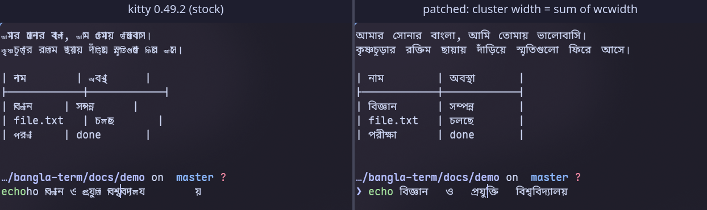

# bangla-term

Bengali in the terminal that renders correctly and stays aligned.

The terminal uses the widths programs already count with (glibc `wcwidth`:
vowel signs and conjunct consonants take a cell, virama and other non-spacing
marks don't). kitty then shapes whole Bengali phrases with HarfBuzz and fits
them into those cells. zsh, bash, tmux, coreutils and less need no change;
Neovim and fzf need small patches. Design and per-program notes:
[docs/SPEC.md](docs/SPEC.md).



| path | what |
|------|------|
| `kitty/` | patch for kitty 0.49.2, enabled with `KITTY_BENGALI=glibc` |
| `nvim/` | patch for Neovim 0.12.6 (same widths when `KITTY_BENGALI=glibc`) |
| `fzf/` | patch for the uniseg library vendored into fzf |
| `font/` | builds Bangla Term Natural (Noto Sans Bengali, scaled 1.15x, unhinted) |
| `tools/fill_ratio.py` | shaped width vs allotted cells under each width rule |
| `try.sh`, `try/` | opens patched kitty with wrapped nvim, tmux, fzf, bat, opencode and Claude Code |
| `claude/osc66-proxy.js` | runs Claude Code in a pty and tells kitty its Bengali widths (OSC 66) |
| `docs/demo/` | the stock vs patched comparison (`shot.sh`) |

## Try it

```sh
make -C font install PYTHON=/path/to/python-with-fonttools

cd ~/src/kitty && git checkout v0.49.2 && git apply ~/src/bangla-term/kitty/kitty-0.49.2-bengali.patch
python3 setup.py build

cd ~/src/bangla-term && ./try.sh     # KITTY_SRC=~/src/kitty BT_NVIM=<patched nvim> by default
```

Neovim: apply `nvim/neovim-0.12.6-bengali-glibc.patch` to v0.12.6 and build.
fzf: see the header of `fzf/uniseg-0.4.7-bengali.patch`.

## Verify

```sh
KITTY_SRC=~/src/kitty NVIM_BIN=~/src/neovim/build/bin/nvim make check
```

Checks kitty's and Neovim's widths against libc `wcswidth` on every line of
`docs/bengali-test.txt`.

## Status

Prototype. Bengali only, switched on by an env var. The width rule is
proposed upstream in [kitty#8533](https://github.com/kovidgoyal/kitty/issues/8533).
Claude Code lays Bengali out narrower (Bun widths); the proxy keeps it intact
but squeezed, and only works in kitty outside tmux.

## License

GPL-3.0, same as kitty. See [LICENSE](LICENSE).
